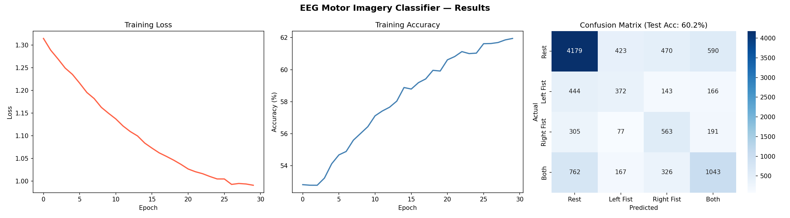

# EEG Motor Imagery Classifier

A PyTorch baseline that classifies four imagined-movement classes from 64-channel EEG recordings across 20 subjects.

| Class | Meaning |
|---|---|
| 0 | Rest |
| 1 | Left fist |
| 2 | Right fist |
| 3 | Both fists / feet |

Brain-computer interfaces (BCIs) let a person control software or hardware by imagining a movement instead of performing it. This project is a proof of concept for the classification step of such a system. It is a notebook-based prototype, not a validated real-time BCI.

## Result

On the held-out test windows, the model reaches **59.16% accuracy** on four classes (random guessing gives 25%). Macro F1 is 0.49.

| Class | Precision | Recall | F1 |
|---|---|---|---|
| Rest | 0.73 | 0.72 | 0.72 |
| Left fist | 0.38 | 0.31 | 0.34 |
| Right fist | 0.37 | 0.49 | 0.42 |
| Both fists / feet | 0.49 | 0.49 | 0.49 |

The model separates rest from movement well and is much weaker at telling left from right. Accuracy alone overstates performance because 54% of the data is the Rest class, so macro F1 is the fairer summary. See [Known limitations](#known-limitations) before reading these numbers as evidence of subject-independent performance.



## Dataset

- PhysioNet EEG Motor Movement/Imagery recordings, loaded from the preprocessed copy in [xiangzhang1015/Deep-Learning-for-BCI](https://github.com/xiangzhang1015/Deep-Learning-for-BCI)
- 20 subjects, 64 EEG channels, 160 Hz sampling rate, about 27 minutes per subject
- Each subject file is a NumPy array of shape (samples, 65): 64 channels plus one label column
- The notebook downloads and extracts the data automatically; the dataset is not stored in this repository

The original labels (0 to 10) are merged into four classes:

| Original labels | Class |
|---|---|
| 0, 1, 10 | Rest |
| 2, 3 | Left fist |
| 4, 5 | Right fist |
| 6, 7, 8, 9 | Both fists / feet |

After combining all subjects there are 512,496 timesteps. The classes are imbalanced:

| Class | Timesteps | Share |
|---|---|---|
| Rest | 276,048 | 53.9% |
| Left fist | 59,112 | 11.5% |
| Right fist | 59,112 | 11.5% |
| Both fists / feet | 118,224 | 23.1% |

## Pipeline

1. **Download and merge.** Load all 20 subject files and map the 11 original labels to 4 classes.
2. **Downsample.** Keep every 10th row (160 Hz to about 16 Hz) to reduce memory use.
3. **Window.** Cut the stream into windows of 16 timesteps with a step of 8 (50% overlap). At 16 Hz each window covers about 1 second. Only windows whose labels are all identical are kept, which gives 51,101 windows.
4. **Reshape.** Arrange each window as (64 channels, 16 timesteps) for `Conv1d`.
5. **Normalize.** Standardize each channel with a `StandardScaler` fitted on the training set only, then applied to the test set.
6. **Split.** Random 80/20 split of windows: 40,880 for training, 10,221 for testing.

| Class | Windows |
|---|---|
| Rest | 28,026 |
| Left fist | 5,769 |
| Right fist | 5,769 |
| Both fists / feet | 11,537 |

## Model

A small 1D CNN with 169,796 trainable parameters:

```
Input: 64 channels x 16 timesteps
Conv1d(64, 64, k=3) -> BatchNorm -> ReLU -> Dropout(0.3)
Conv1d(64, 128, k=3) -> BatchNorm -> ReLU -> Dropout(0.3)
AdaptiveAvgPool1d(4)
Linear(512, 256) -> ReLU -> Dropout(0.5)
Linear(256, 4)
```

## Training

- Loss: cross-entropy with class weights (square root of the balanced weights, so minority classes count more without over-correcting)
- Optimizer: Adam, learning rate 1e-3, weight decay 1e-4
- Schedule: cosine annealing over 30 epochs
- Hardware: CUDA GPU if available, otherwise CPU

## Known limitations

This is an educational baseline. The reported accuracy should not be read as proof of subject-independent BCI performance.

- **Overlapping windows and subject leakage.** The 80/20 split is random over windows. Neighboring windows overlap by 50% and windows from the same person appear in both train and test, so the test set is easier than genuinely unseen recordings. A subject-wise split (or leave-one-subject-out) would give a more honest estimate.
- **Segmentation across subjects.** Subjects are concatenated before windowing, so a window can in principle span two subjects.
- **No validation set.** The best checkpoint is chosen by training accuracy, which favors overfitting.
- **Unfiltered downsampling.** Taking every 10th row without a low-pass filter leaves a Nyquist frequency of 8 Hz, below the mu (8 to 13 Hz) and beta (13 to 30 Hz) bands usually used for motor imagery. Important information may be lost or aliased.
- **Weak movement classes.** Left and right fist F1 scores are 0.34 and 0.42.
- **Not real-time.** The final notebook cell predicts on a stored test window. It is not live EEG inference.
- **Spatial structure ignored.** The CNN treats the 64 channels as feature maps and does not model electrode layout.
- **Reproducibility.** The dataset and trained weights are not committed, and results vary between runs.

## Planned improvements

- Segment each subject separately, then evaluate with a subject-wise split and a validation set
- Apply an anti-aliasing filter before decimation, or train at the full sampling rate
- Select checkpoints on validation performance and report macro F1 alongside accuracy
- Compare against a standard EEG architecture such as EEGNet

## Running the notebook

1. Open `EEG_Motor_Imagery_Classifier.ipynb` in Google Colab or Jupyter (a GPU is recommended; the full dataset needs roughly 13 GB of RAM)
2. Run all cells from the top. The first cell installs PyTorch, NumPy, Matplotlib, scikit-learn, and Seaborn, then downloads the dataset
3. The last cell saves a checkpoint and prints class probabilities for one random test window

## Repository contents

```
EEG_Motor_Imagery_Classifier.ipynb   full pipeline: data, training, evaluation
eeg_results.png                      confusion matrix and training results
README.md
```
